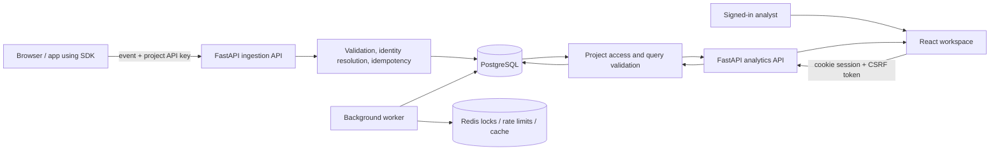

# Product Analytics — Visual End-to-End Walkthrough

Product Analytics is a self-hosted product analytics application. A project receives product events through an ingestion API, resolves event identities into people and sessions, and uses those stored events for charts, funnels, retention, journeys, cohorts, reports, alerts and dashboards.

## How the data moves

The application has two different authentication paths. Product events use a project ingestion key; dashboard and administration actions use an authenticated session and CSRF protection. The browser and API share a same-origin path in the production Nginx configuration.

## Verification status

This walkthrough is backed by the full-stack validation workflow defined at `.github/workflows/full-stack-e2e.yml`. The browser tests create a disposable test account and project, send test events through the real HTTP ingestion endpoint, exercise the saved-analytics forms in the real frontend, and verify records directly against PostgreSQL. These test records are isolated CI data—not production or customer data.

**Evidence rule:** screenshots are captured by Playwright from the running application. The latest full-stack run passed the backend suite, frontend tests, lint/typecheck/build, browser journey, direct SQL assertions and container/SDK smoke test. UI unit tests use Mock Service Worker by design and are regression tests, not proof of persistence; the browser/API/SQL journey is the end-to-end evidence.

## 1. Sign in and create a workspace

The sign-in form sends a real request to `POST /api/v1/auth/login`. An authenticated session is represented by HTTP-only session cookies; protected pages redirect anonymous visitors to sign in.

Create an account with a valid email, a password meeting the policy, and a workspace name. The server normalizes and persists the account and creates its first organization in PostgreSQL.

Create a project for the website or application being measured. The project is the scope used by analytics queries, ingestion keys, event data and saved reports.

The one-time key is returned by the real project-create API. The test runner uses it in memory to submit events, but redacts it before saving the screenshot. The server stores a hash rather than the plaintext key.

## 2. Send events through the real ingestion API

The test browser sends a batch of four isolated test events to `POST /api/v1/events/batch`, authenticated by the new project's API key. The request goes through the same FastAPI ingestion route and service used by the public SDK; it is not intercepted by MSW. Event names include page views, signup completion and purchase completion. Two distinct IDs test person resolution, and stable event UUIDs exercise ingestion idempotency.

The expected response reports four accepted events. The CI validation then queries the PostgreSQL `events`, `persons` and `event_definitions` tables directly. This proves that data was persisted, rather than merely rendered from a fabricated client response.

## 3. Explore and query analytics

### Overview

The Overview page calls the analytics API for KPIs, volume, growth, popular events and pages. Date ranges and project selection change the inputs used by the query.

### Trends

Trends lets an analyst select events, a metric, interval, breakdown and filters. The structured request is sent to `POST /api/v1/analytics/query`; the backend validates the query and calculates its result from persisted events.

The test creates a saved report from the Trends form and verifies the create response. The report is then read back in the Reports workspace.

### Funnels

A funnel measures how users progress through ordered event steps. Test the incomplete-step validation in the interface and confirm the complete query is sent to the analytics endpoint.

### Retention

Retention analyses whether users return after an initial event. Cohort dates, interval, timezone and date range must be represented in the query sent to the backend.

### Journeys

Journeys/paths explore events preceding or following an action. The backend applies project scope and query limits before returning the path result.

## 4. Cohorts, people, and event exploration

### Cohorts

The test creates a cohort for people who performed `purchase_completed`. The UI previews the matching count through the cohort preview API and saves the definition with `POST /api/v1/cohorts`. PostgreSQL is queried after the browser test to confirm the named cohort exists.

### Events

The event explorer supports date ranges, structured filters, pagination and event detail. Selecting an event fetches its stored properties and linked person rather than using static example rows.

### Users and timelines

The user explorer resolves the distinct identifiers observed during ingestion. Opening a person shows the profile and chronological event timeline for that project.

### Sessions

Sessions group events using project/session rules and the selected time range. The frontend uses the session-list analytics API and displays results returned by the server.

## 5. Saved reports and dashboards

### Reports

Reports store a query definition and visualization settings. The walkthrough creates a report through the UI, then checks that the named row exists in PostgreSQL.

### Dashboards

A dashboard can contain saved-report widgets. The test creates a dashboard, adds the report as a widget and saves the layout through a real `PATCH /api/v1/dashboards/{id}` request. The database check verifies that the dashboard persisted.

## 6. Project and workspace administration

### Project settings

Project settings cover the project name, timezone, session timeout, IP handling, event rate limit and restricted properties. Changes are authenticated and should be re-read after saving.

### API keys

Keys can be listed and, according to the role, created, revoked or rotated. A newly created plaintext key is shown once; list responses should not reveal the stored secret.

### Team and roles

Membership and invitations are governed by organization roles. Verify role changes, permission denials, invite revocation and the server-side rule that the final owner cannot be removed or demoted.

### Alerts and notifications

An alert defines a metric, condition and evaluation period, with an optional webhook. The test creates an alert through the real endpoint and confirms the stored row; a configured background worker evaluates enabled alerts and emits notifications.

### Data management

Data management exposes usage and retention controls, event deletion requests, and person erasure. Destructive actions require the appropriate role and explicit confirmation; they should be checked with fresh reads after execution.

### Security

Security settings cover session and password management. The negative-login check deliberately submits an incorrect password, confirms the API returns an authentication failure and a safe user-facing message, then signs in with the valid password.

The password-change flow was exercised through Settings with a disposable CI account. The backend retained the current session and revoked other sessions; the browser then signed out before testing anonymous authentication pages.

The request returns the same public success message whether or not an account exists; backend tests verify that the response does not disclose account existence.

The browser blocks a weak candidate password. A strong candidate with a deliberately invalid token is submitted to the real API, which rejects the token.

The verification page calls the real token-confirmation endpoint and displays the backend's invalid-token response.

After signing out, the previous credential is rejected and the new credential successfully starts a fresh session.

### Event detail, user detail and right-to-erasure

The secondary browser journey opens a persisted event, checks its properties and follows the event's person link to the resolved profile.

The user page shows the profile and event timeline. The test then uses the real destructive-action confirmation to erase the person and associated event rows.

The browser verifies the successful delete response, confirmation message and return to the user list. A database assertion in the updated CI workflow checks that the erased distinct-ID mapping and event rows are both absent.

### API-key rotation

Rotation is performed in the UI. The test verifies that the previous secret receives HTTP 401, while the newly revealed secret can ingest an event. The plaintext key is redacted before the screenshot is saved.

### Alert notifications and read state

The test evaluates an alert against the actual ingested probe event, opens the notification bell, and marks the notification read. The updated workflow additionally queries PostgreSQL to verify the notification has a non-null `read_at`.

### Team invitation lifecycle

A viewer invitation is created and then revoked through the UI. The updated workflow checks that no pending invitation remains for that email in PostgreSQL.

## 7. API and database evidence checklist

| Area | Evidence required | Verified automated coverage |
|---|---|---|
| Registration, login and logout | Live status, session cookies, invalid credentials rejected, logout and new-session login | Browser E2E plus backend auth/session/CSRF/rate-limit tests |
| Password change and recovery | Current password validation, other-session revocation, reset request, invalid reset token and invalid email-verification token | Browser E2E plus backend auth tests |
| Project and settings | Project creation/rename, retention setting and setting persistence | Browser UI/API actions plus direct PostgreSQL assertions |
| API keys | Create, one-time plaintext reveal, revoke, rotation, old key rejection and new key ingestion | Browser UI/API actions; PostgreSQL rotation-state assertion in the updated workflow; backend grace/permission tests |
| Event ingestion | API-key authentication, four accepted events and persisted event/person/definition rows | Browser POST plus direct SQL assertions; backend ingestion suite |
| Overview freshness | Forced refresh after ingestion renders four stored events | Browser assertion against the real overview endpoint; refresh action added for stale cached results |
| Trends, funnels, retention and journeys | Structured query inputs and analytics results | Browser route/network checks plus database-backed analytics tests |
| Events, users and sessions | Explorer list, event detail, user profile/timeline and session calculations | Browser route sweep + secondary E2E detail journey + backend explorer/session tests |
| Cohorts | Preview count, create and persisted definition | Browser preview/create plus direct SQL assertion; backend criteria/filter tests |
| Reports | Save from a real analytics query and persist the report | Browser request plus SQL assertion; backend CRUD/duplicate/ownership tests |
| Dashboards | Create, add saved-report widget and persist layout PATCH | Browser requests plus SQL assertion; backend layout validation tests |
| Alerts and notifications | Create/evaluate, show notification, mark read and persist read state | Browser E2E + PostgreSQL notification read-state assertion in the updated workflow + backend evaluation/notification/webhook tests |
| Export | Direct CSV download and queued worker export/download | Browser download events plus SQL assertion for completed export job; backend format/job tests |
| Destructive/data-management actions | Retention save, purge confirmation guard and UI person erasure | Browser UI/API flow + secondary PostgreSQL assertions for person mappings/event rows; backend erasure test also verifies deletion |
| Operational endpoints | Liveness, readiness and metrics | Backend API suite against migrated PostgreSQL/Redis |
| Team / invitations | Create and revoke a viewer invitation | Secondary browser journey + PostgreSQL check that the pending invitation is gone |
| Build/container quality | Frontend tests, lint, TypeScript, production build, Docker and SDK URL checks | GitHub Actions workflow |
| Page coverage | Captured screenshots from workspace, settings, login/recovery, detail and admin lifecycle pages | Playwright screenshots from the running application; latest green browser run |\n| Database migrations/server regressions | Alembic upgrade and full API suite using real PostgreSQL/Redis | Backend workflow and full-stack workflow |

## 8. Complete registered API route inventory (89 operations)

This is the inventory of active FastAPI routes in the repositories. It documents which operations are registered; it does not claim every route is clicked individually in the browser. Backend tests cover route families and database/validation/auth behavior, while the Playwright journey records actual frontend requests for the flows described in this walkthrough. Braced path segments are path parameters.

### Operations endpoints (3)

| Method | Path |
|---|---|
| GET | /health |
| GET | /ready |
| GET | /metrics |

### Authentication and account security (9)

| Method | Path |
|---|---|
| POST | /api/v1/auth/register |
| POST | /api/v1/auth/login |
| POST | /api/v1/auth/logout |
| GET | /api/v1/auth/me |
| POST | /api/v1/auth/change-password |
| POST | /api/v1/auth/password-reset/request |
| POST | /api/v1/auth/password-reset/confirm |
| POST | /api/v1/auth/verify-email/request |
| POST | /api/v1/auth/verify-email/confirm |

### Organizations, members, invitations and audit log (12)

| Method | Path |
|---|---|
| GET | /api/v1/organizations |
| POST | /api/v1/organizations |
| GET | /api/v1/organizations/{org_id} |
| PATCH | /api/v1/organizations/{org_id} |
| DELETE | /api/v1/organizations/{org_id} |
| GET | /api/v1/organizations/{org_id}/members |
| POST | /api/v1/organizations/{org_id}/members |
| PATCH | /api/v1/organizations/{org_id}/members/{user_id} |
| DELETE | /api/v1/organizations/{org_id}/members/{user_id} |
| GET | /api/v1/organizations/{org_id}/invitations |
| DELETE | /api/v1/organizations/{org_id}/invitations/{invitation_id} |
| GET | /api/v1/organizations/{org_id}/audit-logs |

### Projects, keys, usage, purge and person erasure (12)

| Method | Path |
|---|---|
| GET | /api/v1/projects |
| POST | /api/v1/projects |
| GET | /api/v1/projects/{project_id} |
| PATCH | /api/v1/projects/{project_id} |
| DELETE | /api/v1/projects/{project_id} |
| GET | /api/v1/projects/{project_id}/api-keys |
| POST | /api/v1/projects/{project_id}/api-keys |
| DELETE | /api/v1/projects/{project_id}/api-keys/{key_id} |
| POST | /api/v1/projects/{project_id}/api-keys/{key_id}/rotate |
| GET | /api/v1/projects/{project_id}/usage |
| POST | /api/v1/projects/{project_id}/data/purge |
| DELETE | /api/v1/projects/{project_id}/persons/{person_id} |

### Event ingestion (2)

| Method | Path |
|---|---|
| POST | /api/v1/events |
| POST | /api/v1/events/batch |

### Explorer and metadata (8)

| Method | Path |
|---|---|
| GET | /api/v1/events |
| GET | /api/v1/events/{event_id} |
| GET | /api/v1/users |
| GET | /api/v1/users/{person_id} |
| GET | /api/v1/users/{person_id}/events |
| GET | /api/v1/meta/event-definitions |
| GET | /api/v1/meta/property-definitions |
| GET | /api/v1/meta/property-values |

### Analytics queries (8)

| Method | Path |
|---|---|
| POST | /api/v1/analytics/query |
| POST | /api/v1/analytics/trends |
| POST | /api/v1/analytics/funnels |
| POST | /api/v1/analytics/retention |
| POST | /api/v1/analytics/sessions |
| POST | /api/v1/analytics/paths |
| POST | /api/v1/analytics/sessions/list |
| POST | /api/v1/analytics/overview |

### Cohorts, reports, dashboards, alerts and notifications (27)

| Method | Path |
|---|---|
| GET | /api/v1/cohorts |
| POST | /api/v1/cohorts |
| GET | /api/v1/cohorts/{cohort_id} |
| PATCH | /api/v1/cohorts/{cohort_id} |
| DELETE | /api/v1/cohorts/{cohort_id} |
| POST | /api/v1/cohorts/{cohort_id}/refresh |
| GET | /api/v1/cohorts/{cohort_id}/members |
| POST | /api/v1/cohorts/preview |
| GET | /api/v1/reports |
| POST | /api/v1/reports |
| GET | /api/v1/reports/{report_id} |
| PATCH | /api/v1/reports/{report_id} |
| POST | /api/v1/reports/{report_id}/duplicate |
| DELETE | /api/v1/reports/{report_id} |
| GET | /api/v1/dashboards |
| POST | /api/v1/dashboards |
| GET | /api/v1/dashboards/{dashboard_id} |
| PATCH | /api/v1/dashboards/{dashboard_id} |
| POST | /api/v1/dashboards/{dashboard_id}/duplicate |
| DELETE | /api/v1/dashboards/{dashboard_id} |
| GET | /api/v1/alerts |
| POST | /api/v1/alerts |
| PATCH | /api/v1/alerts/{alert_id} |
| DELETE | /api/v1/alerts/{alert_id} |
| POST | /api/v1/alerts/{alert_id}/evaluate |
| GET | /api/v1/notifications |
| POST | /api/v1/notifications/read |

### CSV/JSON and asynchronous exports (8)

| Method | Path |
|---|---|
| GET | /api/v1/export/events |
| GET | /api/v1/export/users |
| GET | /api/v1/export/reports |
| POST | /api/v1/export/analytics |
| POST | /api/v1/export/jobs |
| GET | /api/v1/export/jobs |
| GET | /api/v1/export/jobs/{job_id} |
| GET | /api/v1/export/jobs/{job_id}/download |

**Router cleanup:** the unused app/api/v1/alerts.py file was removed after verifying that it was not mounted or imported. Duplicate live alert/notification paths already exist in objects.py; mounting both would create conflicting routes. The active paths are represented above.

## 9. Known boundaries

- Screenshots are generated in the CI browser from the running frontend. They are not hand-drawn illustrations or UI-unit-test snapshots.
- The event stream used by this walkthrough is synthetic **test data** created in a disposable CI database. No real customer information or production database is used.
- The existing frontend Vitest suite uses mocked API handlers by design. Its results are useful for UI regression coverage, but not sufficient to claim persistence; the browser/API/SQL workflow is the end-to-end evidence.
- Deployment health, production credentials, SMTP delivery and a production database cannot be certified from repository source alone. The application’s real deployment URL and production configuration must be available for a separate live-environment smoke test.

## 10. Feature inventory and test tracking

| Feature / route | Test target | Status after CI |
|---|---|---|
| Sign in, register, forgot/reset password, email verification and password change | Live API responses, session changes, invalid-token and old/new credential behavior | Browser E2E plus backend auth suite (latest run green) |
| Overview | KPIs, charts, range and project scope | See workflow results |
| Trends | Query, chart/table and save/update report | See workflow results |
| Funnels | Step validation and conversion/drop-off results | See workflow results |
| Retention | Return-period query and heatmap | See workflow results |
| Journeys / paths | Path query and results | See workflow results |
| Cohorts | Preview, create, refresh, list, delete | See workflow results |
| Events | Pagination, filters, event detail, export | Route sweep + secondary event-detail browser test; backend explorer tests |
| Users | List, profile, timeline, and data erasure | Secondary browser journey; backend API/SQL erasure assertions |
| Sessions | Paginated session results | See workflow results |
| Reports | Create, update, duplicate, delete, export | See workflow results |
| Dashboards | Create, edit layout, widgets, duplicate, rename, delete | See workflow results |
| Project settings | Validation and saved settings | See workflow results |
| API keys | Create/list/revoke/rotate; old secret rejected and new secret works | Both browser journeys; backend rotation tests |
| Team / roles | Create/revoke viewer invitation; role and owner boundaries | Secondary browser journey + backend organization tests |
| Alerts / notifications | Evaluate firing alert and mark notification read | Secondary browser journey + backend alert/notification tests |
| Data management | Usage, retention, purge guard, erasure and exports | Browser settings/export journeys + backend direct-delete test |
| SDK | Browser ingestion and public SDK static files | Browser ingestion + container path smoke test |
| Health and readiness | Liveness plus database/Redis readiness | Backend tests + CI service checks |
| Authorization / CSRF / abuse limits | Forbidden access, CSRF, rate limits, payload validation and boundary cases | Backend regression suite |

