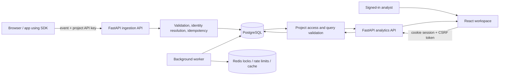

# Product Analytics — Visual End-to-End Walkthrough

Product Analytics is a self-hosted product analytics application. A project receives product events through an ingestion API, resolves event identities into people and sessions, and uses those stored events for charts, funnels, retention, journeys, cohorts, reports, alerts and dashboards.

## How the data moves

The application has two different authentication paths. Product events use a project ingestion key; dashboard and administration actions use an authenticated session and CSRF protection. The browser and API share a same-origin path in the production Nginx configuration.

## Verification status

This walkthrough is backed by the full-stack validation workflow added on the review branch. The browser tests create a disposable test account and project, send test events through the real HTTP ingestion endpoint, exercise the saved-analytics forms in the real frontend, and verify records directly against PostgreSQL. These test records are isolated CI data—not production or customer data.

**Evidence rule:** a screenshot is captured by Playwright from the running application. A workflow run must pass before these images are treated as a verified walkthrough. UI unit tests that use Mock Service Worker are regression tests, not proof of end-to-end persistence.

## 1. Sign in and create a workspace

The sign-in form sends a real request to `POST /api/v1/auth/login`. An authenticated session is represented by HTTP-only session cookies; protected pages redirect anonymous visitors to sign in.

Create an account with a valid email, a password meeting the policy, and a workspace name. The server normalizes and persists the account and creates its first organization in PostgreSQL.

Create a project for the website or application being measured. The project is the scope used by analytics queries, ingestion keys, event data and saved reports.

The one-time key is returned by the real project-create API. The test runner uses it in memory to submit events, but redacts it before saving the screenshot. The server stores a hash rather than the plaintext key.

## 2. Send events through the real ingestion API

The test browser sends a batch of four isolated test events to `POST /api/v1/events/batch`, authenticated by the new project's API key. The request goes through the same FastAPI ingestion route and service used by the public SDK; it is not intercepted by MSW. Event names include page views, signup completion and purchase completion. Two distinct IDs test person resolution, and stable event UUIDs exercise ingestion idempotency.

The expected response reports four accepted events. The CI validation then queries the PostgreSQL `events`, `persons` and `event_definitions` tables directly. This proves that data was persisted, rather than merely rendered from a fabricated client response.

## 3. Explore and query analytics

### Overview

The Overview page calls the analytics API for KPIs, volume, growth, popular events and pages. Date ranges and project selection change the inputs used by the query.

### Trends

Trends lets an analyst select events, a metric, interval, breakdown and filters. The structured request is sent to `POST /api/v1/analytics/query`; the backend validates the query and calculates its result from persisted events.

The test creates a saved report from the Trends form and verifies the create response. The report is then read back in the Reports workspace.

### Funnels

A funnel measures how users progress through ordered event steps. Test the incomplete-step validation in the interface and confirm the complete query is sent to the analytics endpoint.

### Retention

Retention analyses whether users return after an initial event. Cohort dates, interval, timezone and date range must be represented in the query sent to the backend.

### Journeys

Journeys/paths explore events preceding or following an action. The backend applies project scope and query limits before returning the path result.

## 4. Cohorts, people, and event exploration

### Cohorts

The test creates a cohort for people who performed `purchase_completed`. The UI previews the matching count through the cohort preview API and saves the definition with `POST /api/v1/cohorts`. PostgreSQL is queried after the browser test to confirm the named cohort exists.

### Events

The event explorer supports date ranges, structured filters, pagination and event detail. Selecting an event fetches its stored properties and linked person rather than using static example rows.

### Users and timelines

The user explorer resolves the distinct identifiers observed during ingestion. Opening a person shows the profile and chronological event timeline for that project.

### Sessions

Sessions group events using project/session rules and the selected time range. The frontend uses the session-list analytics API and displays results returned by the server.

## 5. Saved reports and dashboards

### Reports

Reports store a query definition and visualization settings. The walkthrough creates a report through the UI, then checks that the named row exists in PostgreSQL.

### Dashboards

A dashboard can contain saved-report widgets. The test creates a dashboard, adds the report as a widget and saves the layout through a real `PATCH /api/v1/dashboards/{id}` request. The database check verifies that the dashboard persisted.

## 6. Project and workspace administration

### Project settings

Project settings cover the project name, timezone, session timeout, IP handling, event rate limit and restricted properties. Changes are authenticated and should be re-read after saving.

### API keys

Keys can be listed and, according to the role, created, revoked or rotated. A newly created plaintext key is shown once; list responses should not reveal the stored secret.

### Team and roles

Membership and invitations are governed by organization roles. Verify role changes, permission denials, invite revocation and the server-side rule that the final owner cannot be removed or demoted.

### Alerts and notifications

An alert defines a metric, condition and evaluation period, with an optional webhook. The test creates an alert through the real endpoint and confirms the stored row; a configured background worker evaluates enabled alerts and emits notifications.

### Data management

Data management exposes usage and retention controls, event deletion requests, and person erasure. Destructive actions require the appropriate role and explicit confirmation; they should be checked with fresh reads after execution.

### Security

Security settings cover session and password management. The negative-login check deliberately submits an incorrect password, confirms the API returns an authentication failure and a safe user-facing message, then signs in with the valid password.

## 7. API and database evidence checklist

| Area | Evidence required | Current automated check |
|---|---|---|
| Registration and login | Real HTTP status, cookies/session, invalid credentials rejected | Browser test plus backend auth tests |
| Project creation and API key | Project row exists; secret is not stored in plaintext | Browser response plus PostgreSQL assertion |
| Event ingestion | API key authentication, accepted count, events/persons/definitions in DB | Browser POST plus direct SQL assertions |
| Analytics query | Frontend POST, non-5xx response and rendered result | Browser network assertion; backend analytics suite |
| Reports | UI create response and matching database row | Browser test plus direct SQL assertion |
| Cohorts | UI create response and matching database row | Browser test plus direct SQL assertion |
| Dashboards | Create, widget-layout PATCH and matching database row | Browser test plus direct SQL assertion |
| Alerts | UI create response and matching database row | Browser test plus direct SQL assertion |
| Page coverage | Screenshots from every registered workspace route | Browser route sweep |
| Build and static quality | Frontend tests, lint, TypeScript, production build and Docker image build | CI workflow |
| Database migrations and backend regressions | Alembic upgrade against PostgreSQL, all backend tests against PostgreSQL/Redis | CI workflow |

## 8. Known boundaries

- Screenshots are generated in the CI browser from the running frontend. They are not hand-drawn illustrations or UI-unit-test snapshots.
- The event stream used by this walkthrough is synthetic **test data** created in a disposable CI database. No real customer information or production database is used.
- The existing frontend Vitest suite uses mocked API handlers by design. Its results are useful for UI regression coverage, but not sufficient to claim persistence; the browser/API/SQL workflow is the end-to-end evidence.
- Deployment health, production credentials, SMTP delivery and a production database cannot be certified from repository source alone. The application’s real deployment URL and production configuration must be available for a separate live-environment smoke test.

## 9. Feature inventory and test tracking

| Feature / route | Test target | Status after CI |
|---|---|---|
| Sign in, register, forgot/reset password, email verification | Form validation, API responses, session and token lifecycle | See workflow results |
| Overview | KPIs, charts, range and project scope | See workflow results |
| Trends | Query, chart/table and save/update report | See workflow results |
| Funnels | Step validation and conversion/drop-off results | See workflow results |
| Retention | Return-period query and heatmap | See workflow results |
| Journeys / paths | Path query and results | See workflow results |
| Cohorts | Preview, create, refresh, list, delete | See workflow results |
| Events | Pagination, filter, detail and export | See workflow results |
| Users | List, detail and event timeline | See workflow results |
| Sessions | Paginated session results | See workflow results |
| Reports | Create, update, duplicate, delete, export | See workflow results |
| Dashboards | Create, edit layout, widgets, duplicate, rename, delete | See workflow results |
| Project settings | Validation and saved settings | See workflow results |
| API keys | Create, list, revoke, rotate and permissions | See workflow results |
| Team / roles | Member invite, role changes, removal and owner safeguards | See workflow results |
| Alerts / notifications | Create, evaluate, notification read state, webhook validation | See workflow results |
| Data management | Usage, retention, purge, erasure and exports | See workflow results |
| SDK | Browser ingestion and public SDK static files | Browser ingestion + container path smoke test |
| Health and readiness | Liveness plus database/Redis readiness | Backend tests + CI service checks |
| Authorization / CSRF / abuse limits | Forbidden access, CSRF, rate limits, payload validation and boundary cases | Backend regression suite |

